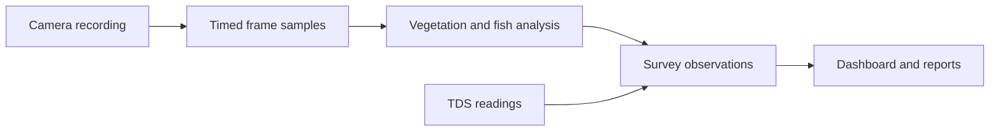
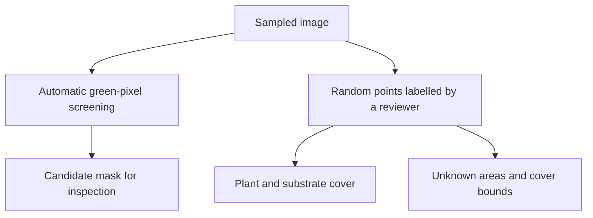
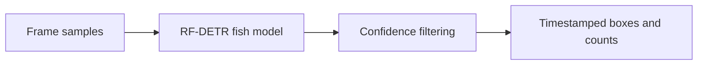

# Computer Vision

## 1. System Overview

Manta Ray uses computer vision to convert underwater recordings into observations of aquatic vegetation, habitat and visible fish. The system combines image analysis with water-quality context to support repeatable aquatic surveys. Its main outputs are vegetation-screening measurements, reviewed plant and substrate cover, automatic fish detections and a three-dimensional reconstruction of surveyed features. Figure 1 outlines the processing and reporting workflow.

The current implementation processes recorded video on a local computer. Onboard processing on a Jetson is a planned extension. The demonstration uses prerecorded footage and explicitly simulated TDS readings; these inputs test the processing pipeline without establishing the actual condition of the filmed water body.

**Figure 1.** Overview of the recorded-video analysis pipeline and the integration of TDS observations into survey reporting.

## 2. Computer Vision Methods

### 2.1. Image Acquisition and Quality Assessment

Video is sampled at a defined interval so each analysed frame retains its time within the recording. Sampling reduces processing demand while preserving a reproducible record of the observations. The vegetation and fish branches prepare images at different resolutions appropriate to their tasks, while maintaining links to the same source video.

The vegetation branch measures brightness and contrast, with additional diagnostics for dark pixels, clipping and image detail. Frames that fail its brightness or contrast checks are excluded from automatic green-cover summaries. A rejected view remains unavailable rather than being recorded as zero vegetation. Passing these checks does not confirm that the bottom is visible; the area used for biological measurement must also be reviewed. Fish detections are generated separately and require their own review for image quality and false positives.

### 2.2. Vegetation and Habitat Analysis

Vegetation analysis combines automatic screening with reviewed image-point measurements, as shown in Figure 2.

#### 2.2.1. Automatic Screening

The screening stage identifies pixels with a sufficiently strong green component and calculates their proportion within the selected image region. The resulting candidate-green mask highlights areas for inspection. It can respond to green water or objects and miss brown vegetation, so its output is retained as a screening measurement rather than accepted plant cover.

#### 2.2.2. Reviewed Image-Point Measurement

Reviewed image-point analysis provides the biological measurement. The system exports frames with reproducible random points, and a reviewer identifies the material beneath each point. Categories include aquatic plants, confidently identifiable filamentous algae, bare sediment, rock, detritus, other bottom organisms and unknown areas. This adapts established benthic image-annotation methods to the project's freshwater survey task [1].

For each frame, the percentage cover of class $k$ is calculated using Equation (1):

$$
C_k = 100\,\frac{n_k}{N_c} \qquad (1)
$$

where $n_k$ is the number of points assigned to class $k$ and $N_c$ is the total number of classified visible-bottom points.

Unknown points are recorded separately. Lower and upper plant-cover bounds show how unresolved points could affect the estimate; these bounds are not statistical confidence intervals. A completely unclassifiable view therefore has missing cover rather than zero plants. Results are summarised within declared survey units, such as transects or quadrats, before combining units. Overlapping video views alone do not establish lakewide vegetation coverage.

**Figure 2.** Vegetation-analysis workflow. Automatic colour screening produces inspection candidates, while reviewed point labels produce biological cover measurements and unknown-area bounds.

This separation supports validation of a future automatic vegetation model against independently reviewed labels. Dense plant segmentation and automatic species identification remain development objectives.

### 2.3. Automatic Fish Detection

The animal-detection branch uses Community Fish Detector RF-DETR Medium, a pretrained model developed using freshwater, marine and laboratory imagery. Its learned visual features locate candidate fish in each sampled frame. The model returns a bounding box and confidence value for each prediction, and the system retains predictions above a configurable threshold, currently 0.5 by default. Confidence is a model output, not a measured accuracy percentage [2].

Figure 3 shows the fish-detection sequence. Each detection is linked to its frame timestamp. The survey summary reports the number of sampled frames containing fish candidates and the maximum number detected together in one frame. Timestamped boxes and confidence values remain available for review. The same fish may appear repeatedly, so detections across frames are not added into a count of unique animals. The model identifies generic fish; other animal groups, species, disease and behaviour are outside its present output.

**Figure 3.** Automatic fish-detection workflow, from sampled frames to timestamped candidate boxes and counts.

The backend also accepts human-reviewed video counts. For stationary recordings with a declared complete review, it calculates MaxN, the maximum simultaneous count for each identified group. Moving-camera or incomplete observations remain descriptive maximum-visible counts. Fish counts are reported alongside vegetation and TDS rather than automatically converted into a health score. They support comparisons between equivalent surveys, but do not independently establish population size, biodiversity or ecological condition.

### 2.4. Three-Dimensional Habitat Reconstruction

The same recording can be processed through COLMAP to reconstruct visible features. The pipeline extracts overlapping views, matches recurring image features, estimates camera positions and generates a sparse three-dimensional point cloud. The dashboard displays this geometry alongside the survey results, providing spatial context for the recorded habitat.

Reconstruction coordinates have arbitrary scale until a known reference establishes physical dimensions. Camera calibration, underwater optical effects and independent geometric checks are required before using the model to report accurate area or volume. Reconstruction supplies geometry; biological identity comes from image interpretation.

### 2.5. Multispectral Screening for Algal Enrichment

Manta Ray also accepts multispectral captures as a separate input to ecological analysis. Camera-specific processing must synchronise and register the bands, convert sensor measurements into calibrated water reflectance, and account for surface reflections. The backend checks acquisition and calibration records and a reviewed quality mask. Non-water objects, glint, shadows, visible bottom, vegetation, saturated pixels and missing data are excluded. An optional camera-specific signal threshold excludes measurements below a documented usable signal level.

For retained pixels, the normalised difference chlorophyll index is calculated using Equation (2):

$$
\mathrm{NDCI} = \frac{R_{\mathrm{red\mbox{-}edge}}-R_{\mathrm{red}}}{R_{\mathrm{red\mbox{-}edge}}+R_{\mathrm{red}}} \qquad (2)
$$

The method uses red and red-edge measurements near 665 and 705–708 nm to describe relative chlorophyll-related spectral contrast [4]. Reports retain index statistics, valid-sample fractions, exclusions and calibration provenance. The file adapter accepts separate calibrated grayscale TIFF or PGM bands and exports a sampled index map and quantitative records. Its documented sampling grid describes sampled pixels rather than full-resolution bloom area. A camera-specific driver supplies captures to this interface.

Elevated or increasing pigment signals can guide investigation of algal enrichment, which can reduce light penetration and oxygen availability [5]. The index does not independently establish chlorophyll concentration, cyanobacterial identity, toxins or overall lake health. Those conclusions require appropriate field measurements and validation. This implementation supports above-water surface observations; submerged downward imagery requires a separately validated optical model.

## 3. Sensor Context and Ecological Analysis

The system's sensing baseline comprises cameras, a TDS probe and an MPU. Cameras provide visible habitat and animal observations. TDS readings describe dissolved-solids context and are matched to video timestamps within a defined tolerance; unmatched readings remain missing. The MPU supplies vehicle acceleration and angular velocity for motion monitoring. Synchronising MPU readings with individual frames for motion-related quality checks is a planned integration, rather than an existing automatic correction.

The analysis preserves the origin of each input. Measured TDS can be compared with a justified site reference when the required context is supplied. Demonstration TDS follows a repeatable, smoothly varying simulated profile and remains labelled as simulated. It cannot change biological cover or fish-count calculations or establish the recording's real chemistry.

Ecological interpretation considers vegetation composition, visible habitat, animal observations and relevant measured water conditions together. Higher plant cover is not automatically deterioration: plant identity, season, habitat and change relative to comparable surveys affect its meaning. Likewise, visual cloudiness is not calibrated turbidity. The current system does not identify dissolved contaminants or determine their effects on wildlife from images and TDS alone.

### 3.1. Extensions to Water-Quality Assessment

Potential additions to the sensing system and their analytical roles are summarised in Table 1.

**Table 1.** Proposed additions to the sensing system. These capabilities require separate integration and validation.

| Proposed addition | Contribution to the analysis |
| --- | --- |
| Dissolved oxygen with water temperature | Adds oxygen availability and thermal context relevant to aquatic life. |
| pH | Adds acidity/alkalinity information to complement TDS and oxygen measurements. |
| Multispectral camera | Could improve vegetation discrimination after underwater calibration and validation. |

These are optional additions requiring a complete fit, power and waterproofing assessment. With suitable repeated measurements and cited objectives, the existing assessment engine can calculate CCME Water Quality Index results. A score such as 80/100 would describe water quality for the specified parameters, site and period; it would not mean that the entire ecosystem is “80% healthy.” Additional probes alone do not establish an adequate monitoring programme [3].

Other supported calculations, such as Carlson's Trophic State Index, require separately supplied measurements of chlorophyll, phosphorus or Secchi transparency. They are not derived from camera greenness or TDS and are not part of the primary camera-analysis workflow.

## 4. Reporting and Validation

The dashboard brings together image-quality summaries, candidate-green measurements, reviewed ecological observations, fish-detection summaries, TDS trends and reconstructed geometry. Downloadable records retain timestamps, methods, model settings, source-file identifiers and exclusions so results can be traced and checked. Automatic detections, reviewed labels and simulated sensor inputs retain distinct roles in interpretation.

Verification includes numerical fixtures, real model inference on saved recordings, calculation checks and backend integration tests. These checks establish software operation. Recognition accuracy must be evaluated separately against independent vegetation labels and reviewed fish observations. Repeated surveys with consistent sampling and calibration are needed before interpreting differences as ecological change.

## References

[1] Beijbom, O., et al. (2015). Towards Automated Annotation of Benthic Survey Images: Variability of Human Experts and Operational Modes of Automation. *PLOS ONE, 10*(7), e0130312. [https://doi.org/10.1371/journal.pone.0130312](https://doi.org/10.1371/journal.pone.0130312).

[2] Varini, F., Morris, D., Burniston, S., Boulais, O., Barnard, K., et al. (2026). *Community Fish Detector*. [Model repository](https://github.com/filippovarini/community-fish-detector).

[3] Canadian Council of Ministers of the Environment (2017). *CCME Water Quality Index User's Manual: 2017 Update*. [Method manual](https://ccme.ca/en/res/wqimanualen.pdf).

[4] Mishra, S., & Mishra, D. R. (2012). Normalized difference chlorophyll index: A novel model for remote estimation of chlorophyll-a concentration in turbid productive waters. *Remote Sensing of Environment, 117*, 394–406. [https://doi.org/10.1016/j.rse.2011.10.016](https://doi.org/10.1016/j.rse.2011.10.016).

[5] U.S. Environmental Protection Agency (2026). *What Are the Effects of HABs?* [Ecosystem effects](https://www.epa.gov/habs/what-are-effects-habs).

Further scientific sources and sampling considerations are retained in [research.md](research.md); operational instructions are in [GUIDE.md](GUIDE.md).
