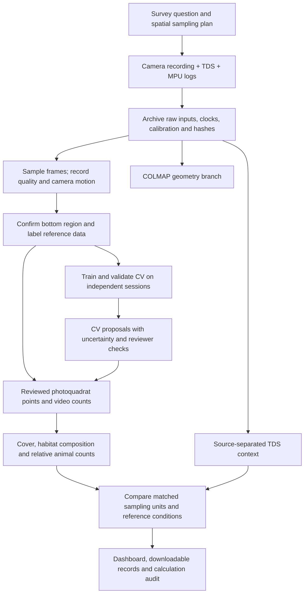

# Camera-led ecological survey research

The research question is: **Can a small flapping-fin robot collect repeatable images that measure aquatic vegetation, habitat and visible aquatic life?** The present sensor set is cameras, a TDS probe and an MPU. The analysis should be designed around those observations. Additional instruments are optional proposals, listed separately below.

[Project overview](README.md) · [Run the pipeline](GUIDE.md)

## Interview and presentation quick reference

**Current sensing:** cameras measure visible habitat/animals; TDS describes dissolved-solids context; the MPU measures vehicle motion. A water-quality score and an ecological-condition assessment are related but different products.

### The two most useful additions

1. **Dissolved oxygen (DO), with water temperature measured alongside it.** DO describes oxygen available to aquatic organisms; temperature affects oxygen solubility and interpretation. Prefer a temperature-equipped DO assembly, or budget a small separate temperature probe. MPU chip temperature is not water temperature. [EPA DO indicator](https://www.epa.gov/national-aquatic-resource-surveys/indicators-dissolved-oxygen), [USGS DO methods](https://www.usgs.gov/water-science-school/science/dissolved-oxygen-and-water)
2. **pH.** Helps characterize acidity/alkalinity and conditions affecting organisms and chemical availability. It adds a different measurement from TDS. Compact DO and pH probes exist, but their conditioning boards, cables, maintenance access, wetted mounting and calibration solutions also need space. Fit must be checked against the actual hull CAD. [California field-measurement guidance](https://www.waterboards.ca.gov/water_issues/programs/swamp/swamp_iq/field_measurements.html), [mini DO candidate](https://atlas-scientific.com/probes/mini-d-o-probe/), [mini pH candidate](https://atlas-scientific.com/probes/mini-ph-probe/)

**Can those produce “80/100”?** They could contribute DO, temperature and pH alongside measured TDS to a limited CCME WQI calculation, provided each parameter has an appropriate, cited objective. That is not automatically a professional whole-ecosystem rating. The CCME manual cautions against fewer than four parameters/four annual visits and recommends 8–20 relevant parameters. Use repeated calibrated observations, expert-selected objectives and supplemental laboratory samples where needed. Present a limited score as exploratory; never count camera greenness or MPU motion as extra chemical parameters. A defensible statement would be “CCME WQI 80/100 for the specified site, period, measured parameters and objectives,” with scope and limitations attached—not “the ecosystem is 80% healthy.” No measured project score exists yet. [CCME manual](https://ccme.ca/en/res/wqimanualen.pdf)

### Vegetation, concisely

- Record repeatable views of the bottom; distinguish plants, visible algae, substrate and unknown areas.
- Estimate projected cover using reviewed random points or a validated segmentation mask: plant hits/pixels divided by the relevant visible-bottom denominator × 100.
- Compare matched sites/seasons and, when identifiable, native/invasive species. More plants is not automatically worse; identity, habitat and change matter.
- Current automatic greenness is a screening hint. Reviewed point-cover calculations work; a locally validated semantic vegetation model is still needed for automatic biological labels. [Image-point method](https://doi.org/10.1016/j.cageo.2005.11.009), [annotation validation](https://doi.org/10.1371/journal.pone.0130312)

### Major assessment approaches

| Approach | Measurements / equipment | How it determines condition |
| --- | --- | --- |
| **CCME Water Quality Index** | Repeated chemistry; relevant probes and/or laboratory samples, with cited local objectives | Combines how many parameters fail, how often, and by how much; 0–100, higher is better for the stated water use. [Manual](https://ccme.ca/en/res/wqimanualen.pdf) |
| **Carlson Trophic State Index** | Chlorophyll-a (lab assay or calibrated fluorometer), total phosphorus (laboratory), Secchi transparency (disk) | Estimates algal trophic state; higher means greater trophic enrichment, not better health. Components need interpretation and are not interchangeable with TDS. [NALMS](https://www.nalms.org/secchidipin/monitoring-methods/trophic-state-equations/) |
| **NSF Water Quality Index** | DO, pH, temperature change, nitrate, phosphate, turbidity, total solids, fecal coliform and biochemical oxygen demand; probes plus laboratory analyses | Combines parameter subindices with weights into a water-quality score; adding two probes does not supply the complete method. TDS is not automatically total solids. [EPA discussion of NSF WQI](https://www.epa.gov/sites/default/files/2020-08/documents/uaa-vol123.pdf) |
| **Biological integrity indices (IBI)** | Standardized fish/invertebrate/plant identification and abundance surveys; cameras can contribute, but sampling/ID may need capture, specimens or microscopy | Compares community metrics with a regional, habitat-specific reference. A generic fish detector alone cannot calculate a validated IBI. [Minnesota lake IBI](https://www.dnr.state.mn.us/waters/surfacewater_section/lake_ibi/lake-index-biological-integrity.html) |
| **EU Water Framework Directive ecological status** | Biological communities plus supporting chemistry and habitat/hydrology measurements | Combines defined assessment elements into high/good/moderate/poor/bad status; not simply a universal percentage. [European assessment framework](https://water.europa.eu/freshwater/europe-freshwater/water-framework-directive/ecological-status-of-surface-water/) |
| **Image-based habitat monitoring** | Calibrated/repeatable camera surveys, reference labels, optional geometry and location | Measures vegetation/substrate cover, visible animal occurrence and change. A site/reference design supplies ecological interpretation; the camera does not identify dissolved contaminants. [Freshwater video-count research](https://doi.org/10.1071/MF23166) |

### Questions for the marine biologist

- Which habitat and ecological question should our camera survey target first?
- Would DO/temperature and pH be the most useful additions for our site, or should we prioritize another parameter?
- Which local objectives and reference sites are appropriate, and is a limited CCME WQI meaningful here?
- What spatial spacing, revisit frequency and camera footprint make our sampling representative?
- Which plant/animal groups can be identified reliably from our actual camera, and how should we validate the detector?
- Which laboratory samples would best complement the robot when assessing nutrients, contamination or effects on wildlife?

### Automatic animal detection

New dashboard image-analysis jobs run **Community Fish Detector RF-DETR Medium (1024)** when the optional runtime is installed. The authors' within-family comparisons favored this model, and its training covers freshwater, marine and lab imagery. No model can be called best for our lake without local reference annotations. It detects generic fish, not every aquatic animal, species, disease or pollution effects. [Model authors and comparisons](https://github.com/filippovarini/community-fish-detector)

The simple UI reports frames with fish candidates, maximum simultaneous detections and the selected confidence threshold, with a JSON download of timestamped boxes. The threshold is not measured accuracy. Counts are unreviewed, not unique fish or a standardized moving-vehicle population estimate. Stock-clip processing tests execution only; independently labeled local footage is still needed to quantify ecological accuracy.


## How researchers assess aquatic ecosystems

Researchers define the habitat, ecological question and sampling design before selecting measurements. Typical questions concern changes in plant distribution, community composition, habitat structure, animal occurrence or water conditions relative to a reference. A naturally vegetated shallow lake can be in good ecological condition. High plant cover alone is not evidence of pollution, and clear-looking water does not establish ecological quality.

For freshwater macrophytes, Wisconsin DNR uses a spatial sampling grid, records plant occurrence and abundance, verifies species, and retains raw site records. Its rake-based point-intercept survey is a useful example of representative sampling, **not a protocol that camera pixels can reproduce directly**. Image cover, rake fullness and frequency of occurrence measure different things. [Wisconsin DNR aquatic plant research and standard protocols](https://dnr.wisconsin.gov/topic/lakes/plants/research)

Underwater photographs and video offer a complementary observation method. A photoquadrat defines a photographed patch; a video transect records a sequence along a route. Researchers identify organisms or substrate within those images, calculate cover or counts, compare observers and repeat the survey. EPA's lake-monitoring manual discusses plant-bed mapping, planned sampling and specimen identification. [EPA, *Volunteer Lake Monitoring: A Methods Manual*, chapters 3–5](https://www.epa.gov/sites/production/files/2015-06/documents/lakevolman.pdf)

Ecological interpretation then compares like habitats, seasons and survey methods, ideally with a suitable reference site or earlier surveys. Plant identity matters: native vegetation, invasive macrophytes, filamentous algae and floating debris are different ecological observations. The robot should produce traceable measurements that support that interpretation, rather than create a universal health score. The broader EPA National Lakes Assessment uses multiple biological, physical and chemical indicators; this project observes a narrower subset. [EPA assessment scope](https://www.epa.gov/national-aquatic-resource-surveys/what-national-lakes-assessment)

## Supported observations

| Measurement | How to obtain it with the current equipment | Appropriate ecological use |
| --- | --- | --- |
| Projected macrophyte cover | Classify random points or pixels within a confirmed visible-bottom region | Compare vegetation extent between comparable quadrats/transects; validate against independent labels |
| Visible algal/substrate composition | Distinguish confidently identifiable filamentous algae, sediment, rock, detritus and other benthos | Describe habitat and visible change; retain unknown labels rather than infer chemistry |
| Aquatic-life observations | Review simultaneous visible counts per taxon in video; later use a validated detector to assist | Occurrence and relative video counts; not total fish population or biomass |
| Recording quality | Image brightness/contrast/blur plus synchronized camera-motion context | Identify unscorable views and improve acquisition |
| TDS | Calibrated probe readings aligned with the recording | Describe ionic/dissolved-solids context or departures from a justified local baseline |
| MPU motion | Acceleration and angular velocity, with clock and mounting calibration | Document motion/tilt and investigate blur; not GPS, water depth or ecological chemistry |

The MVP should prioritize macrophyte cover and substrate composition. Aquatic-life surveys are a separate observation task: the downward-facing vegetation camera may miss fish outside its field of view. If multiple cameras are used, record each camera's role and calibration; two cameras do not automatically form a calibrated stereo system.

## Assessment methods

### Reviewed image-point cover

Random image-point annotation is an established way to estimate benthic composition from photographs or video frames. CPCe overlays random points and classifies the material beneath them; CoralNet research evaluates manual and automated annotation. Their original applications are predominantly marine benthos. **Using the same measurement principle for freshwater vegetation is a project adaptation that needs freshwater labels and validation**, not a claim of compliance with a published lake-health index. [Kohler & Gill, 2006](https://doi.org/10.1016/j.cageo.2005.11.009), [Beijbom et al., 2015](https://doi.org/10.1371/journal.pone.0130312)

The implemented review workflow samples eligible image pixels uniformly without replacement. Its 50-point default is a configurable engineering choice, not a universally sufficient sample size. A reviewer identifies the class directly beneath each point, records a sampling unit and confirms bottom visibility. Use coarse defensible classes first: macrophyte, filamentous algae, bare sediment, rock, detritus, other benthos, unknown and not bottom. Do not assign a species or algal category when image resolution is insufficient.

```text
eligible bottom points = sampled points - not-bottom points
classified bottom points = eligible bottom points - unknown points
class cover (%) = 100 × class hits / classified bottom points
plant lower bound (%) = 100 × plant hits / eligible bottom points
plant upper bound (%) = 100 × (plant hits + unknown hits) / eligible bottom points
```

The reported point estimate is conditional on classification. The unknown bounds show how ambiguity could affect the estimate; they are not confidence intervals. An all-unknown frame has missing classified cover and bounds of 0–100%, rather than zero plants. Excluded views and their reasons remain in the audit. Reports retain frame results, then average equally within declared sampling units and across units. Without independent spatial replicates, the software does not manufacture an inferential confidence interval.

### Aquatic-life video counts

MaxN is the maximum number of individuals of a taxon simultaneously visible in a recording. It avoids summing repeated appearances across frames. Freshwater research uses this metric, but shows that a detector's image-level accuracy does not guarantee accurate ecological counts: Jansen et al. found substantially poorer agreement for derived MaxN than training detection metrics suggested. This supports validating the final ecological output as well as the detector. [Jansen et al., 2024](https://doi.org/10.1071/MF23166)

The backend calculates MaxN for recordings declared stationary and fully reviewed over a stated interval. With a moving camera or incomplete review it reports only the maximum visible count in the reviewed frames. Record taxon labels, explicit zero counts, reviewer, camera mode, start/end time and source hash. Compare recordings only with appropriate control of effort, visibility, camera geometry and habitat. These counts are not unique individuals, density, a census or a whole-lake population estimate. A coarse label such as unidentified fish is not a species.

### TDS and image-quality context

TDS accompanies the biological observations and does not change their cover/count calculations. Conductivity responds to dissolved ions collectively and depends on temperature and water composition. A conductivity-derived ppm estimate requires documented calibration, conversion factor and compensation convention; it cannot resolve phosphorus, toxins or oxygen. [USGS conductivity explanation](https://www.usgs.gov/water-science-school/science/conductivity-electrical-conductance-and-water), [EPA conductivity methods](https://archive.epa.gov/water/archive/web/html/vms59.html)

Use a measured local baseline with comparable site, season, depth and method when interpreting change. There is no universal project TDS threshold for healthy water. Simulated TDS is only a reproducible software scenario: the current seeded smooth profile has a default 150 ppm baseline and ±10 ppm bounds. It is unrelated to the stock video's real chemistry. Reports keep simulated context separate from reviewed biological observations.

## How CV produces ecological measurements

**Segmentation** assigns a class to each pixel; it supports cover because it describes area. **Point classification** assigns classes only at sampled points, reducing annotation effort. **Object detection** locates animals and supports frame counts. **Tracking** links detections over time, but identities can fail under occlusion and camera motion. These outputs answer different questions and need different reference labels.

A practical vegetation model would learn macrophyte, algae, substrate and unknown/obscured classes from researcher-reviewed images. An encoder extracts visual features; a decoder reconstructs a spatial label map. U-Net illustrates this encoder/decoder design, while SUIM provides underwater segmentation research and broad object categories. Neither paper supplies a validated freshwater-lake model for this robot. SUIM's marine imagery and broad classes require a domain-transfer evaluation. [Ronneberger et al., 2015](https://arxiv.org/abs/1505.04597), [Islam et al., 2020](https://arxiv.org/abs/2004.01241)

Training must include brown plants, green water, suspended material, partial occlusion, lighting changes and empty-bottom negatives. Point labels can train a point classifier; they do not automatically supply a dense ground-truth mask. Dense segmentation needs suitable pixel annotations or a separately validated weak-supervision approach. Use a confidence/abstention policy selected on held-out data, and send uncertain cases to a reviewer.

The current RGB green-excess rule is a development baseline and optional annotation hint. It is neither a semantic vegetation classifier nor a measure of ecological condition. Its suggestions never become accepted labels automatically. Beijbom et al. demonstrate the value of human/automation comparisons and clear class definitions; their reported accuracy cannot be copied to this project. [Annotation study](https://doi.org/10.1371/journal.pone.0130312)

## Full data pipeline



1. **Design the survey.** Define a target habitat, ecological question, classes and units of replication. Stratify shallow habitats when needed. Select transects/quadrats before seeing convenient footage. Record the intended camera height, speed, orientation, lighting, season and revisit procedure. Stock clips are development inputs with unknown design, not representative field samples.
2. **Collect and archive.** Preserve original videos, acquisition settings, mission/session/camera IDs, TDS readings, MPU logs, calibration records, operator notes and source/license information. Hash raw inputs; keep processing derivatives separate. Do not overwrite source images with enhanced versions.
3. **Align clocks.** Record video presentation time and sensor/device uptime separately, measure their offset/drift, and document matching tolerance. Keep unmatched readings missing. The current backend joins TDS by nearest clip-relative timestamp; live MPU telemetry exists, but an offline camera/MPU synchronization adapter is still needed before claiming motion-aligned frame quality.
4. **Sample and check quality.** Use a declared temporal/spatial sampling rule and preserve rejected views. Brightness/contrast gates are recording checks. Calibrated camera/MPU mounting and synchronized angular velocity can help assess motion, but cannot prove the bottom is visible. White balancing or enhancement may aid interpretation; retain its parameters and validate that it preserves measurement performance.
5. **Define the denominator.** Confirm visible bottom/canopy, exclude vehicle/water-column regions, and retain ambiguous areas. Use calibrated imaging geometry or reference quadrats for area. The MPU alone cannot supply camera-to-bottom distance. Repeated frames can show the same patch.
6. **Annotate and review.** Export source-linked frames and fixed random points; retain labels, reviewer, class dictionary and unknowns. Double-annotate a subset, inspect disagreement and adjudicate it. Randomize review order where appropriate to reduce expectation effects. NOAA's image-analysis guidance illustrates an operational annotation/QA workflow; freshwater classes and acceptance criteria must be defined for this study. [NOAA CoralNet SOP, 2022](https://repository.library.noaa.gov/view/noaa/42469)
7. **Develop CV.** Split by independent recording session/site before tuning, freeze a held-out set, train the selected classifier/segmenter, and version weights, code, parameters and training-data hashes. Compare with simple baselines. Measure domain shift across sites, cameras and seasons. A pretrained generic-fish model and isolated inference runtime are installed; no local vegetation training dataset or model has been created.
8. **Validate ecological outputs.** Compare predicted cover with independent point/mask references using MAE/bias in percentage points and per-class precision/recall/IoU. Evaluate animal detection and the derived video counts against reviewed video, not only detection mAP. Report unknown/rejection rates and results by independent session. Set acceptance criteria before the final evaluation.
9. **Aggregate and interpret.** Retain per-frame and per-transect results. Account for overlap and footprint/area weights before making lakewide estimates. Use repeated reference surveys to evaluate change. Statistical intervals must respect the independent sampling unit, not treat pixels or neighboring frames as independent lake replicates. Species, season and reference conditions determine ecological meaning.
10. **Publish an inspectable record.** Export observations, raw input IDs/hashes, annotations, source labels, exclusions, methods and versioned calculations. The dashboard presents the evidence and missing information. Simulation stays labeled; a calculation audit does not prove field accuracy.

Freshwater research on submerged vegetation combined underwater-video reference imagery with expert interpretation and spectral measurements. It supports site-specific validation and the distinction between broad cover and species identification, rather than treating green appearance as a species label. [*Multi-Scale Spectral Separability of Submerged Aquatic Vegetation Species in a Freshwater Ecosystem* (2021)](https://doi.org/10.3389/fenvs.2021.760372)

## COLMAP's role

Reconstruction is a geometry branch of the same archived recording. It can help inspect spatial structure and, with validated calibration, scale and registration, support repeat surveys. It does not establish plant taxonomy, biomass or chemistry. SfM estimates camera/point geometry from repeated feature observations; underwater refraction, moving leaves, feature-poor surfaces and camera motion need attention. [Schönberger & Frahm, 2016](https://openaccess.thecvf.com/content_cvpr_2016/html/Schonberger_Structure-From-Motion_Revisited_CVPR_2016_paper.html)

Both supplied clips have already produced real sparse COLMAP models: 29/29 registered views with 14,273 points, and 25/25 views with 8,923 points. These establish pipeline operation and internal registration, not independent physical accuracy. Known reference dimensions and an underwater camera/housing calibration are needed before reporting metric area or volume. The point cloud and image-observation records should retain their common source hash.

## Optional sensor additions

**These are separate proposals, not assumed onboard equipment.** The current baseline remains cameras + TDS + MPU. Select parts only after checking the actual enclosure CAD, connectors, cable bends, power, mass/buoyancy and free pins/bus addresses. No fit claim can be verified from the project description alone.

| Optional addition | Research benefit | Fit and integration decision |
| --- | --- | --- |
| Small water-temperature probe | Supports documented TDS temperature compensation and thermal context | A DS18B20-based probe is a plausible compact candidate: one supplier specifies a 6 mm × 30 mm sensing tube. Cable/penetrator space and a free digital pin still need an audit; that example is not pressure-rated for long-term immersion. |
| Compact water-pressure/depth sensor | Adds water depth for mission and sampling context | Bar02-type sensors use I²C and an M10 bulkhead interface. Check the complete internal body, flat sealing area, cable and bus layout. Depth below the surface still does not measure distance to the bottom. |
| Camera scale/calibration target | Establishes footprint or reference size without another electronic sensor | A known-size tank quadrat is the first option. Verify visibility and viewing geometry; this is preferable to assuming size from the MPU. |
| Multispectral camera | Potentially improves discrimination of specific plant groups after calibration | A future imaging experiment. Verify camera/housing size, spectral bands, illumination and underwater attenuation. A terrestrial vegetation index is not automatically valid underwater. |

Temperature sources: [Analog Devices DS18B20 datasheet](https://www.analog.com/media/en/technical-documentation/data-sheets/DS18B20.pdf), [Adafruit probe dimensions and enclosure limitations](https://www.adafruit.com/product/381). Depth source: [Blue Robotics Bar sensor installation guide](https://bluerobotics.com/learn/bar-sensors-guide/). No additional hardware has been purchased, assigned firmware pins or made a requirement for the image methods.

Dissolved oxygen, nutrients and other chemistry can be valuable in broader studies, but they need their own suitable instruments or partner laboratory samples. They are not part of this robot's present analysis requirements. Existing Carlson/CCME calculations remain readable for archived requests; they are removed from the main camera-method selector and are not the project's research direction.

## Validation and research readiness

The implemented workflow provides reproducible video sampling, green-rule baseline diagnostics, raw review images, random point plans, a local annotation page, complete-label/image-hash checks, reviewed cover and video-count calculations, source-separated TDS, exports and calculation audits. The quality gates, taxonomy and sampling-unit declarations remain subject to reviewer judgment.

The stock footage has no ground-truth ecology or chemistry. No researcher labels have been created by watching it during this work. Synthetic tests can verify denominators, missing-data behavior, reproducibility, provenance and software integration. They do not validate recognition of real plants or animals. Real held-out labels, sensor calibration and an appropriate field design remain necessary for publishable biological conclusions. The next automatic-CV milestone is an independently labeled freshwater development/evaluation dataset, followed by training and ecological-output validation.

## Key scholarly and methodological references

- Kohler, K. E., & Gill, S. M. (2006). *Coral Point Count with Excel extensions (CPCe): A Visual Basic program for the determination of coral and substrate coverage using random point count methodology*. **Computers & Geosciences, 32**, 1259–1269. [DOI](https://doi.org/10.1016/j.cageo.2005.11.009). Supports image-point measurement; marine application, adapted here.
- Beijbom, O., et al. (2015). *Towards Automated Annotation of Benthic Survey Images: Variability of Human Experts and Operational Modes of Automation*. **PLOS ONE, 10**, e0130312. [DOI](https://doi.org/10.1371/journal.pone.0130312). Supports observer comparisons and evaluated human/automation workflows.
- Jansen, A., et al. (2024). *Monitoring tropical freshwater fish with underwater videography and deep learning*. **Marine and Freshwater Research, 75**, MF23166. [DOI](https://doi.org/10.1071/MF23166). Supports freshwater video counts and validation of the derived ecological metric.
- *Multi-Scale Spectral Separability of Submerged Aquatic Vegetation Species in a Freshwater Ecosystem* (2021). **Frontiers in Environmental Science, 9**, 760372. [DOI](https://doi.org/10.3389/fenvs.2021.760372). Supports freshwater reference imagery and limits of species discrimination.
- Ronneberger, O., Fischer, P., & Brox, T. (2015). *U-Net: Convolutional Networks for Biomedical Image Segmentation*. [Author manuscript](https://arxiv.org/abs/1505.04597). Architecture background, not evidence of freshwater model accuracy.
- Islam, M. J., et al. (2020). *Semantic Segmentation of Underwater Imagery: Dataset and Benchmark*. [Author manuscript](https://arxiv.org/abs/2004.01241). Underwater segmentation dataset/model context; domain mismatch requires evaluation.
- Lamirand, M., et al. (2022). *Analysis of Benthic Survey Images via CoralNet: A Summary of Standard Operating Procedures and Guidelines*. NOAA PIFSC Administrative Report H-22-03. [Record and DOI](https://repository.library.noaa.gov/view/noaa/42469). Operational annotation guidance; marine classes are not copied as freshwater standards.
- Schönberger, J. L., & Frahm, J.-M. (2016). *Structure-from-Motion Revisited*. **CVPR**, 4104–4113. [Primary paper](https://openaccess.thecvf.com/content_cvpr_2016/html/Schonberger_Structure-From-Motion_Revisited_CVPR_2016_paper.html). Reconstruction method, not ecological validation.

## Engineering references

The [hardware guide](GUIDE.md#esp32-hardware) retains the current board/pin restrictions and disconnect behavior. Official references are the [Freenove camera pin map](https://github.com/Freenove/Freenove_ESP32_WROVER_Board/blob/main/C/Sketches/Sketch_06.1_CameraWebServer/camera_pins.h), [Espressif MCPWM](https://docs.espressif.com/projects/esp-idf/en/v5.3/esp32/api-reference/peripherals/mcpwm.html), [GPIO restrictions](https://docs.espressif.com/projects/esp-idf/en/v4.4.2/esp32/api-reference/peripherals/gpio.html), [ADC guidance](https://docs.espressif.com/projects/esp-hardware-design-guidelines/en/latest/esp32/schematic-checklist.html#adc), and [camera SCCB driver](https://github.com/espressif/esp32-camera/blob/master/driver/sccb-ng.c). A planned sensor does not imply a free or verified interface.
